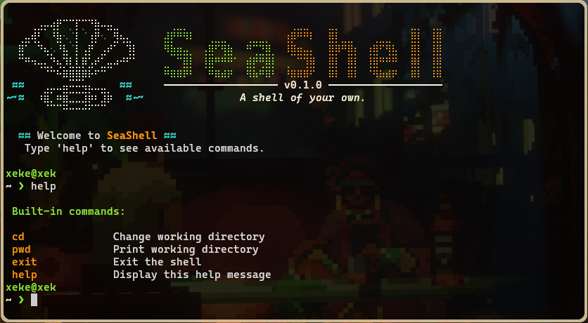

# SeaShell

## About

SeaShell is a personal project to build a Unix-like command-line shell from scratch using C.

The goal is to understand how shells work internally, explore Unix system interfaces, and gain practical experience with process management, command execution, input handling, and eventually I/O redirection and inter-process communication.

Rather than relying on existing shell implementations, SeaShell is built incrementally to understand the mechanisms behind them.

## Features

- **Interactive REPL** — Read, evaluate, print, and repeat.
- **Built-in commands**
  - `cd` — Change the current working directory.
  - `pwd` — Display the current working directory.
  - `help` — Display available built-in commands.
  - `exit` — Exit SeaShell.
- **External command execution** — Execute external programs using `fork()` and `execvp()`.
- **Process management** — Wait for child processes using `waitpid()`.
- **Custom interface** — Minimalist startup banner and a dynamic, two-line prompt.
- **ANSI styling** — Custom terminal colors and formatting.

## Getting Started

### Prerequisites

- Linux or another POSIX-compatible environment.
- GCC or another compatible C compiler.
- A terminal with UTF-8 and ANSI color support.

### Clone the repository

```bash
git clone git@github.com:xekuted/seashell.git
cd SeaShell
```

### Compile

```bash
gcc seash.c parser.c looks.c -o seash
```

### Run

```bash
./seash
```

## Usage

Once SeaShell starts, you can execute built-in and external commands.

```bash
# Display current directory
pwd

# Navigate to another directory
cd /home/user

# Execute external programs
ls
echo "Hello from SeaShell"

# Display available built-ins
help

# Exit
exit
```

## Project Structure

```text
SeaShell/
├── seash.c       # Main shell loop and command execution
├── parser.c      # Command tokenization
├── parser.h      # Parser declarations
├── looks.c       # Terminal appearance and presentation
├── looks.h       # Presentation declarations
└── README.md
```

## Current Limitations

SeaShell is an ongoing learning project. Its current implementation has some limitations:

- Command parsing currently uses simple space-based tokenization.
- Quoted arguments are not supported.
- Command chaining and operators such as `;`, `&&`, and `||` are not implemented.
- I/O redirection and pipes are not implemented.
- Background execution and job control are not implemented.

## Learning Focus

SeaShell is being developed to explore fundamental Unix and operating-system concepts, including:

- Processes and process creation.
- System calls and program execution.
- File descriptors and standard streams.
- Terminal I/O.
- Inter-process communication.
- Signals and process control.
- Command parsing and execution.
